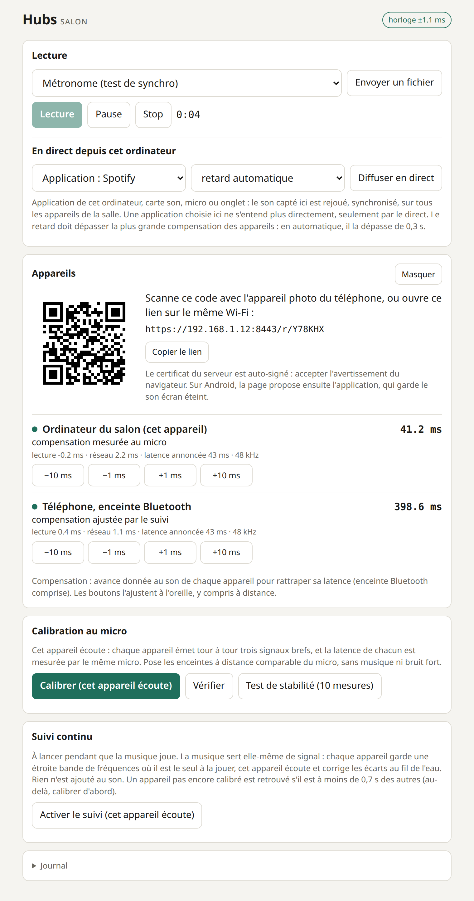
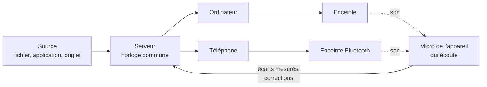

# Hubs

> **In short** — Play the same music, in sync, on several devices (a computer, phones), each on its own
> speaker, Bluetooth included. Hubs uses a microphone to measure what is actually heard, compensates each
> device's latency, then keeps tracking the gap while the music plays. Prototype, AGPL-3.0; documentation in French.

Lecture audio synchronisée sur plusieurs appareils — ordinateur, téléphones — chacun sur sa propre
sortie son : haut-parleur intégré ou enceinte Bluetooth.

Synchroniser des horloges par le réseau ne suffit pas : une enceinte Bluetooth ajoute de 100 à 400 ms
d'un retard que ni le téléphone ni le navigateur ne connaissent. Hubs mesure donc **au micro** ce
qu'on entend vraiment, compense chaque appareil, puis surveille l'écart pendant que la musique joue.

<p align="center">
  
</p>

C'est un prototype : un petit serveur sur l'ordinateur, une page web ouverte sur chaque appareil. Rien
à installer sur les téléphones (une application Android existe pour garder le son écran éteint).

## Ce que ça fait

- **Lecture synchronisée** d'un fichier audio ou d'un métronome, sur tous les appareils d'une salle.
- **Calibration au micro** : chaque appareil émet un signal bref, un seul micro mesure la latence de
  chacun, la compensation s'applique toute seule.
- **Suivi continu** : pendant la lecture, la musique elle-même sert de signal de mesure et les écarts
  sont corrigés au fil de l'eau, sans rien ajouter au son.
- **Direct** : ce qui joue sur l'ordinateur — une application comme Spotify, un onglet, une entrée
  audio — ressort, synchronisé, sur tous les appareils.
- **Salles** : une adresse `/r/CODE` par salle, qu'on rejoint sans compte, par un lien.
- **Application Android** : la même page, qui continue de jouer écran éteint.

## Démarrage rapide

Il faut Node 18 ou plus récent et `openssl` (pour le certificat), et un navigateur récent sur chaque
appareil. Le serveur n'a aucune dépendance.

```sh
node server.mjs
```

1. Sur l'ordinateur, ouvrir <http://localhost:8080>, se connecter (sans identifiants Google, une
   connexion de développement est proposée), créer une salle et l'ouvrir.
2. Sur les autres appareils, sur le même Wi-Fi, ouvrir le lien `https://…:8443/r/CODE` affiché dans la
   salle. Le certificat est auto-signé : accepter l'avertissement (hors de `localhost`, le navigateur
   n'ouvre le micro et le lecteur audio de la page qu'en HTTPS).
3. Cliquer **Rejoindre** sur chaque appareil.
4. Choisir **Métronome** puis **Lecture** : sans calibration, on entend le décalage entre les clics.
5. Sur l'ordinateur, **Calibrer**, puis **Vérifier** : l'écart entre appareils doit être proche de 0.
6. Envoyer un morceau ou lancer un direct, puis **Activer le suivi** pour que l'écart reste corrigé.

## Utilisation

### Calibration et suivi

- **Calibrer** : chaque appareil émet trois signaux brefs, le micro de l'appareil qui écoute mesure la
  latence de chacun et la compensation est appliquée automatiquement.
- **Vérifier** rejoue les signaux avec compensation : l'« écart entre appareils » doit être proche de 0.
- Les boutons ± ms ajustent chaque appareil à l'oreille, y compris à distance.
- **Test de stabilité** : dix mesures à la suite, sans toucher à la compensation. Le résumé donne la
  variation de l'écart entre appareils ; c'est elle qui dit si une calibration unique suffit.
- **Suivi continu** (pendant que la musique joue) : l'appareil qui écoute mesure l'écart entre
  appareils toutes les 6 à 10 s dans la musique elle-même et le corrige. Il retrouve aussi un
  appareil pas encore calibré, ou dont l'enceinte a changé, jusqu'à 0,7 s des autres, et le
  rattrape d'un coup ; la calibration reste plus rapide et plus sûre pour démarrer.

Chaque mesure est gardée dans l'historique de la page et écrite dans la sortie du serveur.

Mieux vaut que ce soit l'ordinateur qui écoute : sur téléphone, ouvrir le micro peut changer le trajet
du son (mode « appel », profil Bluetooth mains-libres) et fausser la mesure.

### Direct : l'ordinateur diffuse vers les appareils

Dans une salle, le créateur dispose d'un bloc « En direct depuis cet ordinateur » : il choisit une
source, un retard, et tout ce qui y joue ressort, synchronisé, sur les appareils de la salle (chacun
sur son enceinte). Sources possibles :

- **Une application de cet ordinateur** (Linux, PipeWire ou PulseAudio) : Spotify, un lecteur
  vidéo… Elle apparaît dans la liste dès qu'elle a un son ouvert, même en pause : la choisir, lancer
  le direct, c'est tout. Le serveur la déplace sur une sortie virtuelle et capte ce qui en sort : elle
  ne s'entend donc plus directement, seulement par le direct, et retrouve sa sortie à l'arrêt.
  Proposé au créateur de la salle, sur la machine qui héberge le serveur. Le navigateur qui affiche
  la salle n'est pas proposé : il rejoue le direct, le capter bouclerait.
- **Son d'un onglet** (Chrome ou Edge sur ordinateur) : partager l'onglet où joue la musique en
  cochant le partage du son. L'onglet est rendu muet sur place, il ressort par le direct.
- **Entrée audio** : carte son, table de mixage, micro. Attention au micro intégré : il capte la
  pièce, donc aussi les enceintes.
- **Câble virtuel**, pour réunir plusieurs applications ou régler soi-même le trajet du son. Sous
  Linux : `tools/linux-virtual-input.sh on`, puis diriger les applications vers la sortie
  « Cable-direct » et choisir l'entrée « Source-direct » comme source du direct (`off` pour le
  retirer). Sous Windows et macOS, des outils comme VB-Cable ou BlackHole jouent le même rôle.

Le retard (1 s par défaut) sépare la capture de l'écoute : il doit dépasser la plus grande
compensation des appareils d'environ 0,3 s. Il rend le direct inadapté à qui doit entendre son
propre geste sans délai : pour mixer, on écoute au casque et la salle suit avec ce retard.

Le son voyage en clair et sans compression (environ 1,5 Mbit/s par appareil), via le serveur. Le
direct est pensé pour un usage personnel, chez soi : à chacun de respecter les conditions des
services dont il rediffuse le son.

### Application Android

Dans un navigateur, Android coupe le son d'une page peu après l'extinction de l'écran. L'application
(`android/`) affiche la page de la salle telle quelle et la garde active écran éteint : service de
premier plan, processeur et Wi-Fi maintenus éveillés, page tenue pour visible. Elle ne fait que
cela : synchro, calibration et direct sont ceux de la page.

```sh
android/build.sh publish   # construit android/build/hubs.apk et le dépose dans public/
```

- **Installer** : sur le téléphone, ouvrir l'adresse du serveur suivie de `/hubs.apk`
  (`https://…:8443/hubs.apk`) et accepter l'installation depuis le navigateur.
- **Ouvrir une salle** : saisir l'adresse du serveur (`192.168.1.12:8443`) ou le lien de la salle.
  L'application montre l'empreinte du certificat, à comparer à celle que le serveur affiche au
  démarrage ; une fois acceptée, seul ce certificat passe. La dernière salle se rouvre au lancement.
- **Arrêter** : « Retour » laisse le son continuer, comme un lecteur de musique ; « Arrêter » est
  dans la notification.
- L'application est un appareil distinct du navigateur du même téléphone : elle a son propre nom
  et sa propre compensation, à calibrer.

Construction sans Gradle : un JDK et le SDK Android (`build-tools;35.0.0`, `platforms;android-35`),
désignés par `JAVA_HOME` et `ANDROID_HOME` (par défaut `~/Android/jdk-21` et `~/Android/Sdk`).
Android 10 au minimum. L'APK est signé par une clé de développement créée à la première
construction ; `HUBS_KEYSTORE` et `HUBS_KEYSTORE_PASS` désignent une autre clé.

## Comment ça marche



- **Horloge commune** : chaque page estime son décalage avec l'horloge du serveur (allers-retours HTTP,
  on garde le plus court).
- **Lecture** : le serveur diffuse « position P à l'heure T » ; chaque page programme le son dans son
  horloge audio, en avance de sa latence, puis corrige la dérive en continu (vitesse ±1 % au plus).
- **Calibration** : un balayage 1–6 kHz de 150 ms par créneau ; l'appareil qui écoute le retrouve par
  corrélation croisée (`public/dsp.js`). Un seul micro mesure tout le monde, donc sa propre latence
  s'annule dans les écarts.
- **Suivi continu** : la musique sert de signal de mesure. Chaque appareil a une bande de 600 Hz
  (entre 3,4 et 6,9 kHz) où il est le seul à la jouer : pendant le suivi, les autres la retirent de
  leur musique. Le micro corrèle ce qu'il entend avec la musique dans la bande de chaque appareil,
  par blocs de 171 ms dont on additionne les énergies pendant 5,5 s. Rien n'est ajouté au son, et
  un appareil bien moins fort que les autres reste mesurable puisqu'il est seul dans sa bande.
  Une enceinte lointaine arrive surtout par la pièce, en une bosse étalée sur des dizaines de ms :
  on mesure donc le début de l'arrivée (front montant du profil lissé), pas un pic. L'appareil le
  mieux reconnu sert de référence ; l'écart des autres vient du cumul de leurs six dernières
  fenêtres, recalées sur lui. Les corrections sont prudentes : rien sous 2 ms d'écart, 6 ms au plus
  par pas. Quatre appareils au plus.
- **Recherche élargie** : une analyse ne couvre que ±85 ms. Un appareil que le micro entend dans sa
  bande sans le trouver près de la référence est cherché dans la même fenêtre, décalée par pas de
  120 ms jusqu'à ±0,7 s. Une musique rythmée donne de faux pics à une mesure d'écart : il faut un
  score de 12 sur une fenêtre, de 10 sur deux ou de 8 sur trois cumulées (rejouées contre une
  musique décalée, les captures réelles ne dépassent pas 6,7, 5,9 et 5,3). Un appareil retrouvé à
  plus de 40 ms des autres est rattrapé d'un coup.
- **Direct** : l'hôte découpe le son capté en tranches de 100 ms, chacune datée de l'heure commune
  de sa capture. Une droite ajustée sur ces dates donne le rythme réel de sa carte son ; chaque
  appareil lit le flux avec un lecteur à vitesse variable asservi à cette horloge, pour faire
  entendre chaque échantillon un retard fixe après sa capture. Le suivi continu s'applique tel quel,
  la référence étant le flux reçu. Pour une application, c'est le serveur qui capte (`parec` sur la
  sortie virtuelle) et date les tranches à leur arrivée, en gardant les arrivées les moins retardées.
- **Sortie maintenue éveillée** : chaque page joue en permanence un bruit infime (−80 dB), pour que la
  sortie audio ne se mette pas en veille pendant les silences et ne change pas de latence au réveil.

## Comptes et salles

- **Salle** : une adresse `/r/CODE` avec ses propres appareils, sa lecture et son suivi. On la rejoint
  sans compte, avec le lien ou le code.
- **Compte** : nécessaire pour créer une salle (10 au plus) et y envoyer un morceau. Connexion par
  Google (OpenID Connect, flux « code » avec PKCE) ; la session tient dans un cookie signé.
- Sans identifiants Google, une **connexion de développement** sans mot de passe est proposée, depuis
  la machine qui héberge le serveur seulement.

Configuration, par variables d'environnement :

| Variable | Rôle |
|---|---|
| `GOOGLE_CLIENT_ID`, `GOOGLE_CLIENT_SECRET` | Identifiants OAuth « application Web » créés dans la console Google Cloud, avec `PUBLIC_URL/auth/callback` comme URI de redirection autorisée. |
| `PUBLIC_URL` | Adresse publique du service (défaut : `http://localhost:8080`). |
| `HTTP_PORT`, `HTTPS_PORT` | Ports d'écoute (défaut : 8080 et 8443). |
| `SESSION_SECRET` | Clé de signature des sessions (sinon générée dans `data/`). |
| `TRUST_PROXY=1` | Derrière un mandataire qui termine le HTTPS : cookies marqués `Secure`. |
| `DATA_DIR` | Comptes, salles et clé de session (défaut : `data/`, hors git). |
| `DEV_LOGIN=1` / `0` | Force ou interdit la connexion de développement. |

## État du projet et limites

Hubs est un prototype, fait pour un réseau local. Un seul essai sur du vrai matériel à ce jour, le
9 octobre 2026 : un ordinateur et un téléphone, chacun sur une enceinte Bluetooth (latences mesurées :
environ 150 ms et 400 ms), musique diffusée en direct depuis Spotify. Après calibration, le suivi a
mesuré entre les deux un écart médian de 1 ms au plus, et inférieur à 3 ms sur 204 fenêtres de
mesure sur 205. Le reste est validé par des tests automatiques, en simulation et en boucle interne.

- La synchro n'est exacte qu'à l'emplacement du micro (le son parcourt environ 3 ms par mètre).
- Le suivi continu ne mesure que quand la musique joue et contient de l'énergie entre 3 et 7 kHz. Il
  cherche un appareil jusqu'à 0,7 s des autres : au-delà, il faut calibrer.
- Pendant le suivi, chaque appareil joue la musique avec une bande étroite en moins.
- Sous Firefox, la position de lecture flotte d'environ ±1 ms.
- Le trajet du micro ajoute à toutes les mesures un décalage commun qui dérive : seules les valeurs
  relatives entre appareils sont fiables, les latences absolues ne le sont pas.
- Sources : métronome ou fichier audio local envoyé depuis la page (gardé en mémoire, 80 Mo max).
  Pour un MP3, utiliser le même navigateur partout (le décodage n'ajoute pas le même silence initial
  selon les navigateurs).
- Dans un navigateur : écran du téléphone allumé et page au premier plan, sinon le son est suspendu.
  L'application Android lève cette limite ; elle a été vérifiée dans un émulateur (Android 14, écran
  éteint puis veille profonde forcée). Sur un téléphone, l'économie d'énergie du constructeur peut
  encore l'arrêter : l'exclure alors de l'optimisation de la batterie.
- Direct d'une application : sous Linux seulement, une seule à la fois par machine. Si le serveur est
  tué sans pouvoir réagir (`kill -9`, panne), l'application reste sur la sortie virtuelle, donc
  muette : relancer le serveur, puis lancer et arrêter un direct de cette application la remet sur
  la sortie par défaut. Pas d'enregistrement de diagnostic pendant un direct.
- Pas prêt pour un service ouvert sur Internet : comptes et salles dans des fichiers JSON, morceaux
  gardés en mémoire, son du direct en clair et sans compression, pas de limitation de débit, un seul
  processus.

## Développement

```sh
npm test               # traitement du signal, horloges, comptes et salles, direct d'une application
npm install            # une fois, pour les tests suivants (puppeteer-core)
npm run smoke          # bout en bout dans Chrome sans écran : lecture, calibration, suivi, direct
npm run smoke:firefox  # le même scénario sous Firefox
npm run android        # construit l'application Android
```

Les tests n'émettent aucun son : comptes vérifiés contre un faux fournisseur d'identité, calibration
et suivi en boucle interne, capture d'une application remplacée par une fausse.

| Dossier | Contenu |
|---|---|
| `server.mjs`, `server/` | Serveur : fichiers statiques, horloge, comptes (`auth.mjs`), salles (`rooms.mjs`), capture d'une application (`app-audio.mjs`). |
| `public/` | Pages et traitement du signal : calibration et suivi (`dsp.js`), horloges (`sync.js`), direct (`live.js`), page d'une salle (`app.js`). |
| `android/` | Application Android et son script de construction. |
| `test/` | Tests unitaires et de bout en bout. |
| `tools/` | Analyse hors ligne des enregistrements du micro, câble audio virtuel pour Linux. |

### Diagnostic

Pendant le suivi, l'appareil qui écoute envoie au serveur ce que son micro entend (s'il tourne sur la
même machine). Les douze dernières fenêtres et le morceau joué sont gardés dans `captures/CODE/` ;
`node tools/analyze-capture.mjs` rejoue la mesure dessus, recherche élargie comprise (nécessite
`ffmpeg`).

## Licence

Hubs est distribué sous la [licence publique générale GNU Affero, version 3](LICENSE) (AGPL-3.0).
Chacun peut l'utiliser, le modifier et le redistribuer. Une version modifiée doit rester sous la même
licence, avec son code source, y compris quand elle est seulement proposée comme service en ligne.
Le logiciel est fourni sans aucune garantie.

Copyright © 2026 Augustin Bresset
